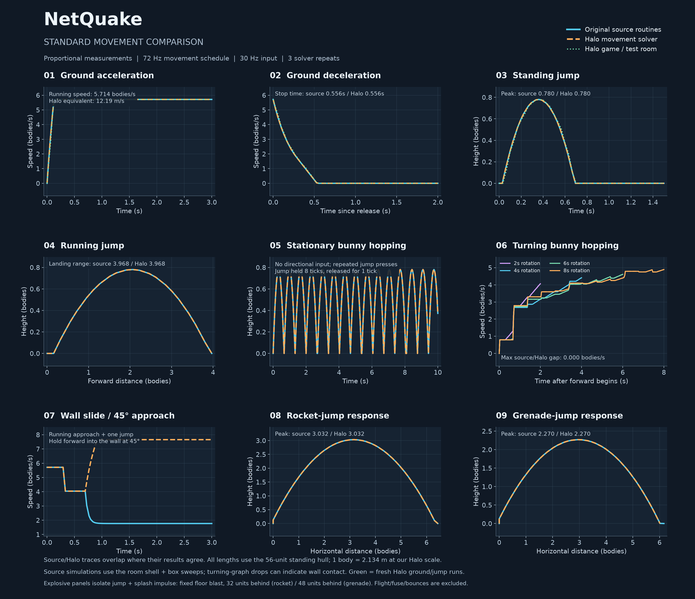
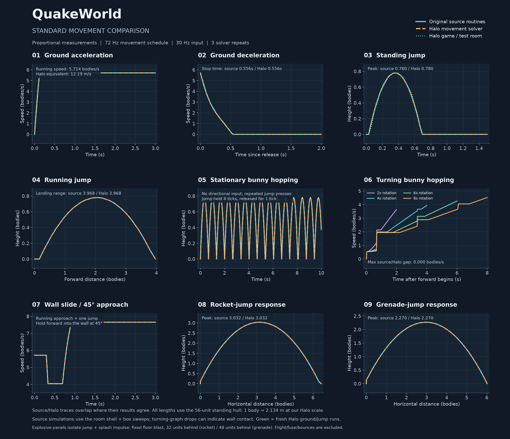
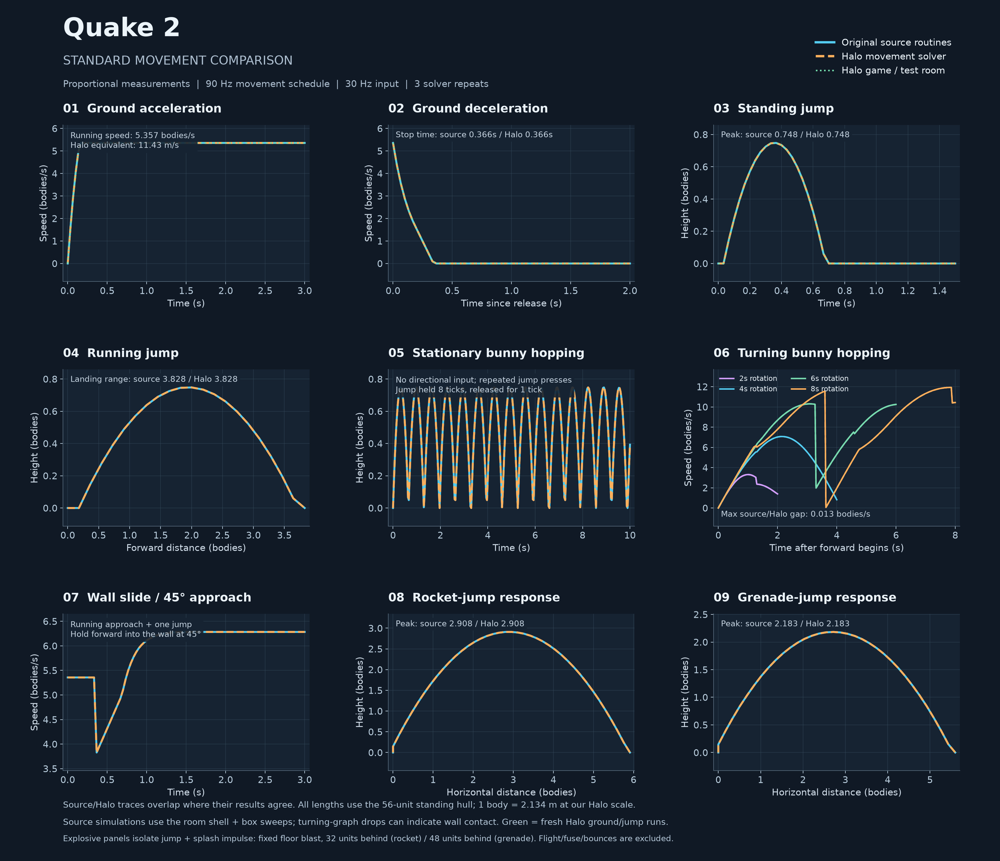
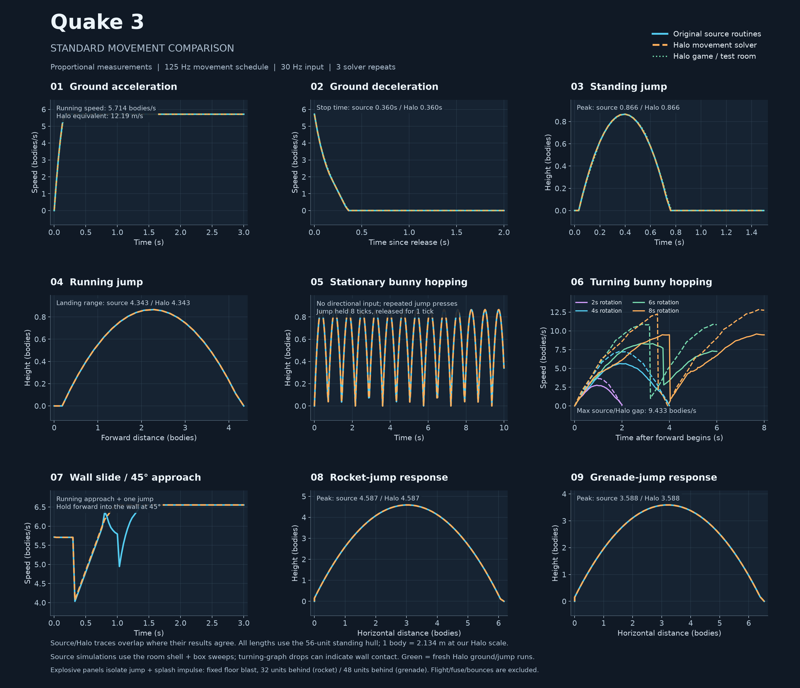

# OpenCE Quake Edition

Forked from [OpenCommunityEdition/OpenCE](https://github.com/OpenCommunityEdition/OpenCE).

## Change physics

1. Open **Settings → Controls Setup** from the main menu or in-game pause menu.
2. Controls Setup opens on **Movement**. Move the **Show** selector left once to **Physics**.
3. Use left/right or the arrow buttons to change these options:

   | Option | Choices |
   | --- | --- |
   | **Style** | Halo CE, NetQuake, QuakeWorld, Quake 2, Quake 3 |
   | **Rocket/Grenade** | Halo CE, Quake 1, Quake 2, Quake 3 |
   | **Speed Display** | Off, On — horizontal speed below the crosshair in m/s |

4. Select **OK** to save, or **Cancel** to discard changes. **Defaults** selects Halo CE for both styles and turns Speed Display off.

Movement and rocket/grenade styles are independent. In multiplayer, each player
can choose their own styles; changes take effect on their next respawn.
Speed Display takes effect when saved.

## Movement comparisons

These graphs compare original-source movement simulations with the Halo solver
using proportional measurements. Green traces are recorded Halo test-room
ground-movement and standing-jump runs. Explosive-jump panels compare controlled
blast responses; they exclude projectile flight, fuse timing and bounces.

### NetQuake

### QuakeWorld

### Quake 2

### Quake 3

